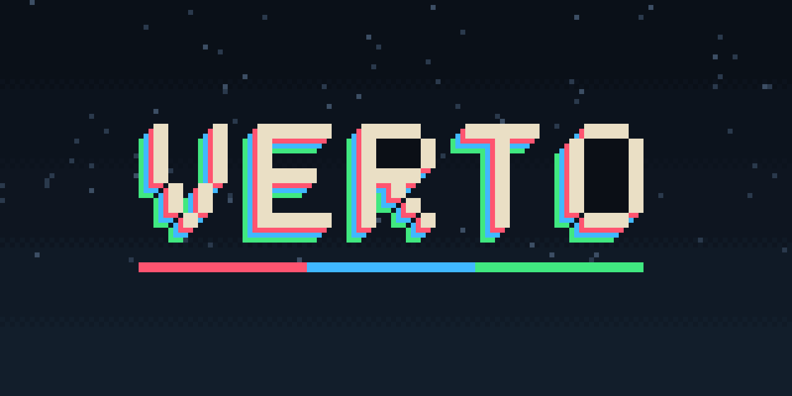

# Verto

Verto is the next version of PHASE, the GDRC jam game. [Play the jam version on itch.io](https://swear01.itch.io/phase).

[中文 Wiki：背景、操作、物件與關卡製作](Documentation/Wiki.md)。

[Play the Web preview](https://verto.5334601.xyz/).

Unity **6000.6.7f1**. Open `Assets/Scenes/PhaseTitle.unity` and press Play: the title's
icons start the [eight-room demo](Documentation/Demo.md), pick any level, open the level
editor or open settings (key bindings and fullscreen). Escape in a level pauses with the same choices. The player only runs
and jumps: every jump, including wall jumps and jump-crystal air jumps, cycles red → blue → green, and
terrain, spikes and lasers exist only in their colors. The jam levels stay as placeholders until they are
redesigned. Crossing the right edge advances to a fresh room checkpoint; the game view has no explanatory text.
The original `PhaseSandbox` / `PhaseRoom2` test scenes remain available.

The pixel view fills the window at any aspect ratio, keeping 180 native pixels
high with point sampling. Wide rooms extend the quarry and walkable floor; narrow
views follow the player. Fullscreen is a switch in the in-game settings, and room
travel uses a quick horizontal slide.
`PhaseTerrain`, `PhaseSpike`, `PhaseLaser` and `PhaseCrystal` are reusable Inspector components.

Development uses **Unity CLI + Unity Pipeline** against a running Editor.
See [development and verification](Documentation/Development.md) and
[art direction](DESIGN.md) and [movement attribution](Documentation/ThirdPartyNotices.md).

For browser play, [build the Web preview or enable Web CI/Pages](Documentation/Web.md).
